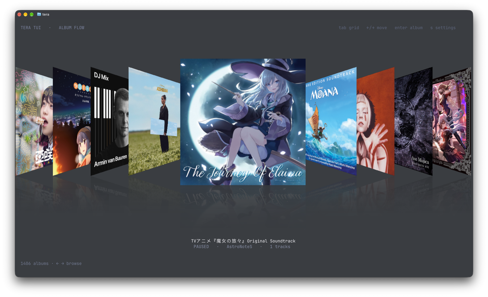
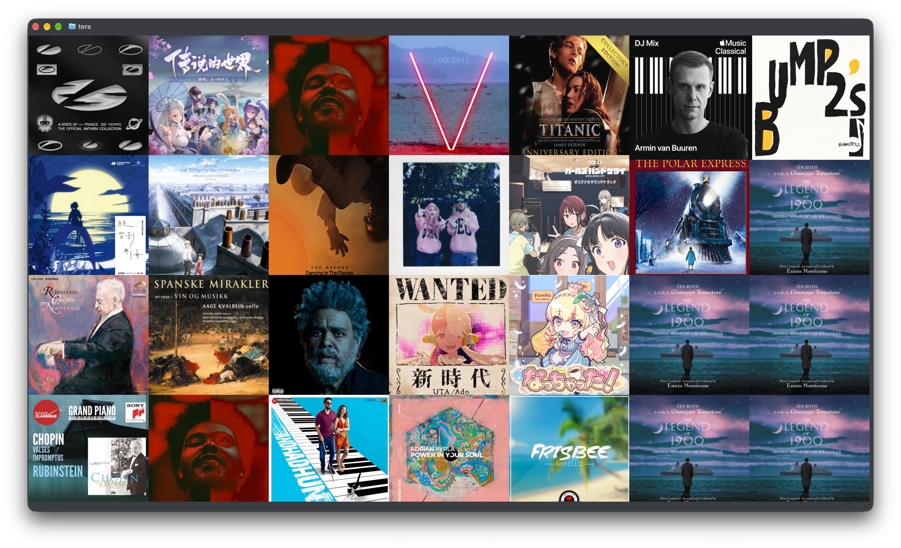

<h1 align="center">tera</h1>

<p align="center">
  <a href="README.md">简体中文</a> &nbsp; / &nbsp; <strong>English</strong>
</p>

<p align="center">
  <strong>Album flow and album grid, in your terminal.</strong>
</p>

<p align="center">
  <code>tera</code> is inspired by Sleeve and Apple Cover Flow: browse your Music.app library as a horizontal cover flow or a tiled album grid, overlay
  high-resolution artwork through the Kitty graphics protocol, and leaves playback to Music.app.
  It paints no background, so your terminal's transparency and blur show through.
</p>

<p align="center">
  
  &nbsp;
  
  &nbsp;
  
  &nbsp;
  
  &nbsp;
  
</p>

<br>

<p align="center">
  
  
</p>

<p align="center">
  <a href="https://ghostty.org"></a><br>
  <sub>Best with <a href="https://ghostty.org"><strong>Ghostty</strong></a></sub>
</p>

---

> [!IMPORTANT]
> This project is only a UI and remote control for Music.app. Playback, library data and DRM remain
> with Apple Music; nothing here bypasses DRM or modifies Apple services.

## Quick start

Requires macOS 14+, a stable Rust toolchain, and a Music.app library. Ghostty or Kitty is recommended.
The first run asks for Automation access to Music. Tera restores the last view and the last selected Cover Flow album at startup.

```bash
git clone https://github.com/pentaoa/tera.git
cd tera
cargo run --release
cargo run --release -- --synthetic   # no Music access needed
```

Transparency is controlled by the terminal; tera never paints the background:

```ini
# ~/.config/ghostty/config
background-opacity = 0.85
background-blur = true
```

## Features

| | |
| --- | --- |
| **Album Flow** | Horizontal cover flow, thirteen perspective frames, baked mirror reflections, bottom-aligned |
| **Album grid** | A fixed album wall (Tab) with timed transitions and click-to-open albums |
| **High-res art** | Kitty graphics on Ghostty/Kitty; half-block pixel fallback elsewhere |
| **Responsive** | Cover size, spacing and text follow the terminal size |
| **Transparent** | Only artwork and text are drawn; no background fill |
| **Playback** | Enter opens the selected album and its track list, Space toggles play/pause in Music.app |
| **Library** | Groups tracks by album title and album artist; compilations without an album artist use Various Artists |

## Rendering

1. Half-block pixel canvas (`▀` carries two vertical pixels per cell).
2. Dirty-cell diff against the previous frame; stale text and covers are erased each frame.
3. `unicode-width`-aware cursor tracking for CJK titles.
4. Synchronized updates (`CSI ? 2026 h/l`).
5. Configurable 30, 60 or 120 fps frame loop (60 by default).
6. Kitty images uploaded on demand, placements updated when changed with sub-cell `X`/`Y` offsets.
7. Thirteen Y-rotation angles generated on demand per cover, with a vertically mirrored alpha reflection baked in.

Bench (200×60, animated): **1900+ fps** encoder, **~68 KB/frame**, **~8.0 MB/s at 120 fps**.
The actual frame rate depends on the terminal and display; this is not vertical sync.

## Scroll click

The click is synthesised at startup from the formula below: 44.1 kHz, 18 ms, 793 frames.

```rust
const SR: f64 = 44_100.0;
let n = (SR * 0.018) as usize;          // 793
let mut seed: u64 = 0x9E37_79B9;
let mut buffer = vec![0.0f32; n];

for i in 0..n {
    let t = i as f64 / SR;
    let p = i as f64 / (n - 1) as f64;

    // 8% attack, then exp(-10.5 * p) decay
    let env = ((p / 0.08).min(1.0) * (-10.5 * p).exp()) as f32;

    // 64-bit LCG noise, take bits 33..48
    seed = seed
        .wrapping_mul(0x5851_F42D_4C95_7F2D)
        .wrapping_add(1);
    let noise = ((((seed >> 33) & 0xFFFF) as f64 / 32768.0) - 1.0) as f32;

    // 2650 Hz fundamental + 5300 Hz harmonic + noise
    let wave = ((t * 2.0 * std::f64::consts::PI * 2650.0).sin() as f32) * 0.34
        + ((t * 2.0 * std::f64::consts::PI * 5300.0).sin() as f32) * 0.18
        + noise * 0.18;

    buffer[i] = wave * env * 0.34;
}
```

| Parameter | Value |
| --- | --- |
| Sample rate | 44.1 kHz |
| Frames | `floor(44100 * 0.018) = 793` |
| Noise | 64-bit LCG, seed `0x9E3779B9`, multiplier `0x5851F42D4C957F2D`, bits 33..48 mapped to `[-1, 1]` |
| Envelope | 8% linear attack, then `exp(-10.5 * p)` |
| Fundamental | 2650 Hz, amplitude 0.34 |
| Harmonic | 5300 Hz, amplitude 0.18 |
| Noise amplitude | 0.18 |
| Overall amplitude | multiplied by 0.34 |

The buffer is normalised to 0.85 peak, then scaled by the user volume (default 0.22). Playback uses
`cpal` directly, one tick per album crossing, 35 ms throttled, up to 8 voices.

```bash
tera --mute
TERA_CLICK=0 tera
TERA_CLICK_VOLUME=0.35 tera
tera --no-haptic
```

## Keys

| Key | Action |
| --- | --- |
| ← / h | Previous album |
| → / l | Next album |
| Enter / i | Open selected album; play the selected track in details |
| Esc | Return from album details |
| s / , | Open settings for artwork, effects and menu layout |
| Space | Play / pause |
| s | Open settings (arrows adjust, including scroll sensitivity) |
| Tab | Toggle flow / grid |
| q / Esc | Quit |

## Limitations

- Perspective uses thirteen on-demand angle frames, so transitions between angles are stepped.
- No search, lyrics or progress bar yet.
- High-resolution artwork requires Kitty graphics (Ghostty / Kitty).
- macOS only: library, artwork and playback go through Music.app automation.
