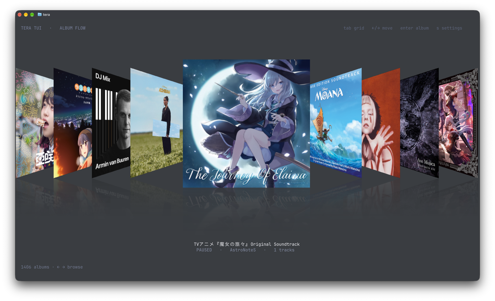
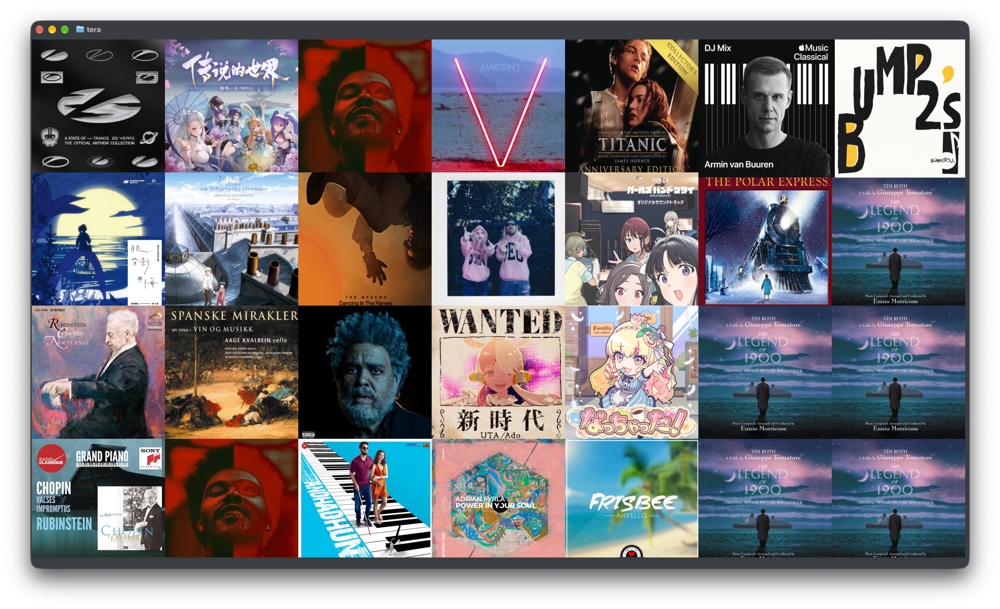
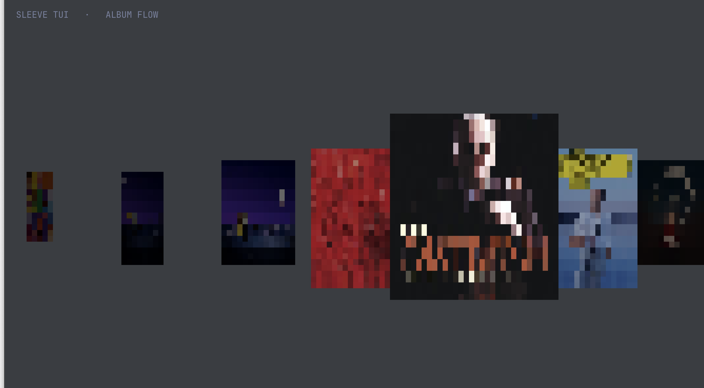

<h1 align="center">tera</h1>

<p align="center">
  <strong>简体中文</strong> &nbsp; / &nbsp; <a href="README.en.md">English</a>
</p>

<p align="center">
  <strong>终端里的专辑流：Cover Flow、平铺专辑墙与高清封面</strong>
</p>

<p align="center">
  <code>tera</code> 灵感来源于 Sleeve 与 Apple Cover Flow：读取 Music.app 资料库，横向 Cover Flow 或平铺浏览专辑，
  高清封面直接叠在字符网格上，播放始终交给 Music.app。界面不绘制背景，完全跟随终端的透明与模糊。
</p>

<p align="center">
  
  &nbsp;
  
  &nbsp;
  
  &nbsp;
  
  &nbsp;
  
</p>

<p align="center">
  <a href="#快速开始"><strong>开始使用</strong></a> &nbsp; / &nbsp;
  <a href="#显示内容">功能一览</a> &nbsp; / &nbsp;
  <a href="#渲染管线">渲染管线</a> &nbsp; / &nbsp;
  <a href="#快捷键">快捷键</a>
</p>

<br>

<p align="center">
  
  
</p>

<p align="center">
  <a href="https://ghostty.org"></a><br>
  <sub>与 <a href="https://ghostty.org"><strong>Ghostty</strong></a> 搭配体验最佳（Kitty graphics + 透明背景）</sub>
</p>

---

> [!IMPORTANT]
> **使用声明：** 本项目只做界面与播放控制，音乐播放、资料库和版权仍由 Apple Music / Music.app 负责，
> 不绕过 DRM，也不修改任何 Apple 服务。

## 快速开始

**需要：** macOS 14 或更新、Rust 稳定版、Music.app 里已有资料库；推荐 Ghostty 或 Kitty。
设置保存在 `~/.config/tera/settings.json`；上次的浏览视图及 Cover Flow 专辑会在启动时恢复。首次运行会请求“控制 Music”的自动化授权，允许后即可读取专辑、封面并控制播放。封面更换后如需刷新，可删除 `~/Library/Caches/tera/art` 中的缓存。

```bash
git clone https://github.com/pentaoa/tera.git
cd tera
cargo run --release
```

没有授权或只想看界面，可以用合成封面：

```bash
cargo run --release -- --synthetic
```

**透明背景**由终端决定。`tera` 只画封面和文字，不填充背景，所以 Ghostty 的透明/模糊会直接透出来：

```ini
# ~/.config/ghostty/config
background-opacity = 0.85
background-blur = true
```

调整窗口大小时，主封面、间距和文字位置会按当前终端分辨率重新计算；Kitty 封面也会随 `c`/`r`
缩放，不会出现旧位置残留。

## 显示内容

| 视图 | 内容 |
| --- | --- |
| **Album Flow** | 横向 3D 封面轮播，选中封面居中放大，左右封面透视重叠，缓动跟随 |
| **专辑库（平铺）** | 按 Tab 切换的固定专辑墙，定时随机替换封面；点击封面打开专辑 |
| **透视与反射** | Cover Flow 封面按需生成 13 档 Y 轴透视帧；下方烘焙淡出的镜像反射 |
| **高清封面** | Ghostty/Kitty 下用 Kitty graphics 直接贴原图（含透视帧）；其他终端回退到半块像素（`▀`） |
| **自适应布局** | 主封面按窗口宽高自适应，高度按半块像素保持正方形；文字、间距、可见数量随分辨率变化 |
| **透明背景** | 不绘制全屏背景，只画封面和文字；终端透明、模糊、壁纸都能透出 |
| **播放控制** | Enter 打开专辑并选歌，Space 播放/暂停，状态直接读 Music.app |
| **资料库** | 批量读取 Music 资料库；按专辑名与专辑艺术家分组，合辑缺少专辑艺术家时使用 Various Artists；封面按 persistent ID 懒加载，并缓存在内存和 `~/Library/Caches/tera/art` |

<p align="center">
  
</p>

没有 Kitty graphics 时自动回退到半块像素：每个字符用 `▀` 同时携带上下两个像素，分辨率减半但仍然是真彩色。

## 渲染管线

终端要高刷新，关键不是“画得快”，而是“每帧只发变化的部分”。

1. **半块像素画布**：每个 cell 用 `▀` 同时设置 fg（上半像素）和 bg（下半像素），
   120×40 的终端就是 120×80 的像素画布；封面在 CPU 上采样、缩放、透视剪切。
2. **脏单元 diff**：每帧把画布重置为透明默认值，再与上一帧做 diff，只发送变化的 cell。
   旧文字、旧封面位置会以空格 + 默认色被擦除，不会滞留。
3. **宽字符安全**：按 `unicode-width` 计算光标前进宽度，跳过宽字符的 continuation cell；
   CJK 专辑名和艺术家名不会让后续 cell 错位。
4. **同步输出**：每帧包在 `CSI ? 2026 h` / `l` 中，避免撕裂。
5. **帧循环**：可在设置中选择 30、60 或 120 fps，默认 60 fps；实际显示由终端和显示器决定。
6. **Kitty 高清层**：封面 PNG 按需上传（image id），位置变化时用同一个 placement id 更新位置和
   `c`/`r` 尺寸；`X`/`Y` 提供亚 cell 像素偏移，移动比整格跳动平滑。离开视野的 placement
   按 id 删除，不重传图片。
7. **透视帧**：Cover Flow 的封面按需在后台生成 13 档 Y 轴旋转角度（-1.05 到 1.05），
   每帧按距离选择最近的角度帧，中心封面也带倒影；半块模式则直接做逐像素逆透视采样。
8. **反射**：透视帧生成时把卡片垂直翻转、加 alpha 渐隐，直接烘焙在卡片下方；半块模式通过抖动保留终端背景，模拟渐隐倒影。侧边封面相互重叠并按远近排序。

CPU 侧基准（200×60 画布，持续位移动画）：

```text
bench: 600 frames = 1900+ fps encode (0.52 ms/frame)
       avg 68 KB/frame → 8.0 MB/s @120fps
```

实际帧率由终端、窗口大小和显示器决定；帧率设置是目标值，并不提供垂直同步。

## 快捷键

| 按键 | 操作 |
| --- | --- |
| <kbd>←</kbd> / <kbd>h</kbd> | 上一张专辑 |
| <kbd>→</kbd> / <kbd>l</kbd> | 下一张专辑 |
| <kbd>Enter</kbd> / <kbd>i</kbd> | 打开当前专辑；详情内 Enter 播放选中的歌曲 |
| 详情内 <kbd>Esc</kbd> | 翻回专辑浏览 |
| <kbd>Space</kbd> | 播放 / 暂停 |
| <kbd>Home</kbd> / <kbd>End</kbd> | 第一张 / 最后一张 |
| <kbd>Tab</kbd> | 在 Album Flow 与平铺专辑库之间切换 |
| <kbd>↑</kbd> / <kbd>↓</kbd> | 专辑详情或设置中移动 |
| 鼠标滚轮 | 在 Cover Flow 中浏览专辑；详情内浏览歌曲 |
| <kbd>s</kbd> / <kbd>,</kbd> | 打开设置；可调整显示与交互选项，并在「keyboard shortcuts」查看快捷键 |
| 点击封面 | 平铺模式点击打开专辑 |
| <kbd>q</kbd> / <kbd>Esc</kbd> | 退出 |

<details>
<summary>调试与基准参数</summary>

| 参数 | 作用 |
| --- | --- |
| `--synthetic` | 用合成渐变封面，不访问 Music.app |
| `--no-kitty` | 强制半块像素回退 |
| `--bench N` | 离屏跑 N 帧，输出编码 fps、每帧字节数和带宽 |
| `--dump` | 导出单帧 cell 到 `/tmp/tera_dump.csv` |
| `TERA_START=N` | 启动时定位到第 N 张专辑 |
| `TERA_DEMO=1` | 每 1.2s 自动下一张，便于观察动画和残留 |
| `TERA_VIEW=grid` / `TERA_VIEW=flow` | 覆盖上次视图，启动时进入指定模式 |

</details>

## 滚动咔哒声

咔哒声在启动时按下面的公式合成，不依赖外部音频文件。采样率 44.1kHz，时长 18ms，共 793 帧：

```rust
const SR: f64 = 44_100.0;
let n = (SR * 0.018) as usize;          // 793
let mut seed: u64 = 0x9E37_79B9;
let mut buffer = vec![0.0f32; n];

for i in 0..n {
    let t = i as f64 / SR;
    let p = i as f64 / (n - 1) as f64;

    // 前 8% 淡入，之后按 exp(-10.5 * p) 衰减
    let env = ((p / 0.08).min(1.0) * (-10.5 * p).exp()) as f32;

    // 64 位线性同余噪声，取 bit 33..48
    seed = seed
        .wrapping_mul(0x5851_F42D_4C95_7F2D)
        .wrapping_add(1);
    let noise = ((((seed >> 33) & 0xFFFF) as f64 / 32768.0) - 1.0) as f32;

    // 2650Hz 基频 + 5300Hz 二次谐波 + 噪声
    let wave = ((t * 2.0 * std::f64::consts::PI * 2650.0).sin() as f32) * 0.34
        + ((t * 2.0 * std::f64::consts::PI * 5300.0).sin() as f32) * 0.18
        + noise * 0.18;

    buffer[i] = wave * env * 0.34;
}
```

参数汇总：

| 参数 | 值 |
| --- | --- |
| 采样率 | 44.1kHz |
| 帧数 | `floor(44100 * 0.018) = 793` |
| 噪声 | 64 位 LCG，种子 `0x9E3779B9`，乘数 `0x5851F42D4C957F2D`，取 bit 33..48，映射到 `[-1, 1]` |
| 包络 | 前 8% 线性淡入，之后 `exp(-10.5 * p)` |
| 基频 | 2650Hz，幅度 0.34 |
| 二次谐波 | 5300Hz，幅度 0.18 |
| 噪声幅度 | 0.18 |
| 整体幅度 | 再乘 0.34 |

生成后把峰值归一化到 0.85，再乘用户音量（默认 0.22）。播放用 `cpal` 直接推 CoreAudio，
每次跨过一张专辑触发一次，35ms 节流，最多 8 个 voice 叠加。

```bash
tera --mute                    # 本次静音
TERA_CLICK=0 tera              # 永久关闭声音
TERA_CLICK_VOLUME=0.35 tera    # 调大一点
tera --no-haptic               # 只保留声音，不振动
```

触控板轻振通过 AppKit 的 `NSHapticFeedbackManager`（`NSHapticFeedbackPatternAlignment`）实现，
和声音共用同一个“跨过一张专辑”的 tick，55ms 节流。只在 Force Touch 触控板上有效。

## 目录

```text
tera/
├── src/main.rs    帧循环、布局、半块渲染、diff 编码、bench/dump
├── src/music.rs   JXA 批量元数据、AppleScript 封面导出、播放控制
├── src/kitty.rs   Kitty graphics：上传、placement 更新、删除
└── assets/        README 截图
```

## 已知限制

- Kitty 层的透视使用按需生成的 13 档角度帧，不是每帧实时形变；角度之间仍有轻微跳变。
- 暂无搜索、歌词、播放进度条；平铺视图暂不支持拖拽。
- 高分辨率封面依赖 Kitty graphics（Ghostty / Kitty）；其他终端自动回退。
- 只支持 macOS：资料库、封面和播放都通过 Music.app 的 AppleScript/JXA 完成。
